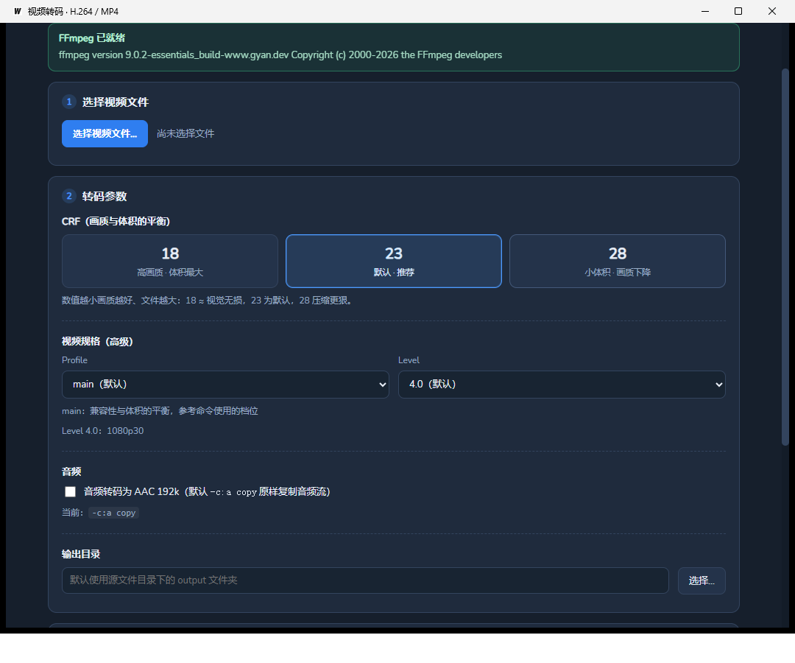

# 视频转码（Wails + FFmpeg）

用 Wails v2 + Go 封装的 FFmpeg 转码小工具：选择视频文件 → 显示原始编码信息 → 选择 CRF（以及
Profile / Level）→ 转码为 H.264 / MP4（默认 `high` profile、`level 4.1`、`yuv420p`、`+faststart`）。



## 核心命令

界面里做的，等价于下面这条命令（`FILE_NAME` 为所选文件）：

```bash
FILE_NAME="xxx.mp4"
ffmpeg -i "$FILE_NAME" \
  -c:v libx264 \
  -profile:v high \
  -level 4.1 \
  -pix_fmt yuv420p \
  -crf 18 \
  -c:a copy \
  -movflags +faststart "output/$FILE_NAME"
```

与上面命令的差异都是**可见的**（界面上「命令预览」会显示最终参数，并在需要时列出说明）：

| 差异                                                                     | 原因                                               |
| ------------------------------------------------------------------------ | -------------------------------------------------- |
| 参数中的 `-y`                                                            | 无人值守覆盖同名输出文件，避免 ffmpeg 卡在交互提问 |
| 参数中的 `-progress pipe:1 -nostats`                                     | 向界面推送百分比 / 速度 / 剩余时间                 |
| 源文件不是 mp4/mov/m4v 时输出改名为 `.mp4`                               | `-movflags +faststart` 只对 mov 系容器有效         |
| 音频与 MP4 不兼容（如 Opus、Vorbis、PCM）时自动改为 `-c:a aac -b:a 128k` | `-c:a copy` 会直接失败                             |
| 含图形字幕（PGS / VOBSUB）时追加 `-sn`                                   | MP4 无法承载图形字幕，否则 ffmpeg 报错             |
| 输出到「源文件目录 / output /（原文件名）」                              | 对应命令里的 `output/$FILE_NAME`                   |
| 可改选 `-profile:v` / `-level`（默认不变）                               | 4K 等素材用默认的 level 4.1 会直接失败，需要能调整 |

## 界面功能

- **选择视频文件**：弹出文件对话框（默认过滤常见视频扩展名）。
- **原始编码信息**：`ffprobe` 读出容器、时长、大小、总码率、视频流（编码 / Profile / Level /
  分辨率 / 宽高比 / 帧率 / 像素格式 / 位深 / 码率 / 色彩 / 扫描方式）、音频流（编码 / 采样率 /
  声道 / 码率 / 采样格式）与音视频轨数。
- **风险提示**：音频与 MP4 不兼容、分辨率/帧率超出所选 level 上限、奇数边长、图形字幕等情况会给出说明。
- **CRF 选择**：18（高画质）、**23（默认）**、28（小体积）。
- **Profile / Level（高级）**：默认 `high` + `4.1`，可改为 `main` 以及
  `3.1`~`5.2` 各档，或选择「自动」不传 `-level` 交给 x264 决定。选中文件后会按分辨率与帧率算出所需
  的最低等级：若所选档位不够，会提示并给出一键应用的按钮。
- **音频选项**：默认 `-c:a copy`，可改为 AAC 128k。
- **输出目录**：默认源目录下的 `output`，可另选；同时显示最终输出文件名。
- **命令预览**：转码前就能看到完整命令行。
- **进度与日志**：百分比、速度、fps、剩余时间、已写入大小，以及可展开的 ffmpeg 日志；支持中途取消
  （会删除未完成的输出文件）。

### 关于 Profile / Level

`-level` 不是画质选项，而是**硬性上限**（宏块数与宏块率），选低了 ffmpeg 会直接报错：

| Level | 典型能力       | 说明                           |
| ----- | -------------- | ------------------------------ |
| 3.1   | 720p30         | 兼容性最好                     |
| 4.0   | 1080p30        | 分辨率上限同 4.1               |
| 4.1   | 1080p30 高码率 | **默认**，码率上限更高         |
| 4.2   | 1080p60        | 1080p 高帧率                   |
| 5.0   | 1440p30        |                                |
| 5.1   | 4K30           | 4K 素材的最低选择              |
| 5.2   | 4K60           |                                |
| 自动  | 由编码器决定   | 不写 `-level`，x264 自行标注   |

`-profile:v` 影响同画质下的体积：`main`（兼容性与体积平衡）、`high`（默认，开 CABAC /
8x8 变换，体积更小，但少数老设备不支持）。两者都与强制的 `yuv420p` 8bit 兼容，因此可以安全地开放给
用户选择；不兼容的档位（如需要 10bit 的 `high10`）不会出现在列表里，非法取值也会被后端收敛回默认档。

## 环境要求

- Windows + WebView2 运行时
- Go 1.25+（本项目用 1.27.1 验证）
- Node.js（构建前端）
- **FFmpeg**：按下面的顺序查找 `ffmpeg` / `ffprobe`
  1. 环境变量 `FFMPEG_PATH` / `FFPROBE_PATH` 指定的可执行文件；
  2. 应用自带的 `bin` 目录（可执行文件同级，或当前工作目录下的 `bin`）——本项目 `bin/` 里已放入
     ffmpeg / ffprobe 9.0.2，构建后会优先使用它；
  3. 系统 `PATH`。
     界面顶部会显示实际使用的版本，检测不到时会给出提示。

## 开发与构建

```bash
wails dev     # 热重载开发
wails build   # 产物：build/bin/wails-proj.exe
```

## 代码结构

| 文件                                      | 作用                                                                          |
| ----------------------------------------- | ----------------------------------------------------------------------------- |
| `app.go`                                  | 绑定给前端的方法：环境检测、文件/目录对话框、媒体探测、在资源管理器中定位输出 |
| `media.go`                                | `ffprobe` JSON 解析与人类可读格式化、风险提示                                 |
| `transcode.go`                            | 命令行构建、后台任务、`-progress` 解析、事件推送、取消与清理                  |
| `process_windows.go` / `process_other.go` | 隐藏子进程控制台窗口、打开文件管理器                                          |
| `transcode_test.go`                       | 端到端测试（真实调用 ffmpeg，校验 faststart、取消清理等）                     |
| `frontend/src/main.ts`                    | 界面逻辑（原生 TypeScript，无框架）                                           |
| `frontend/src/api.ts`                     | 对 `window.go.main.App` 的类型化封装                                          |
| `frontend/src/types.ts`                   | 与 Go 返回值对应的类型定义                                                    |

## 测试

```bash
go test ./...        # 需要 PATH 上有 ffmpeg/ffprobe，缺省时自动跳过
go test -short ./... # 只跑不依赖 ffmpeg 的用例
```
